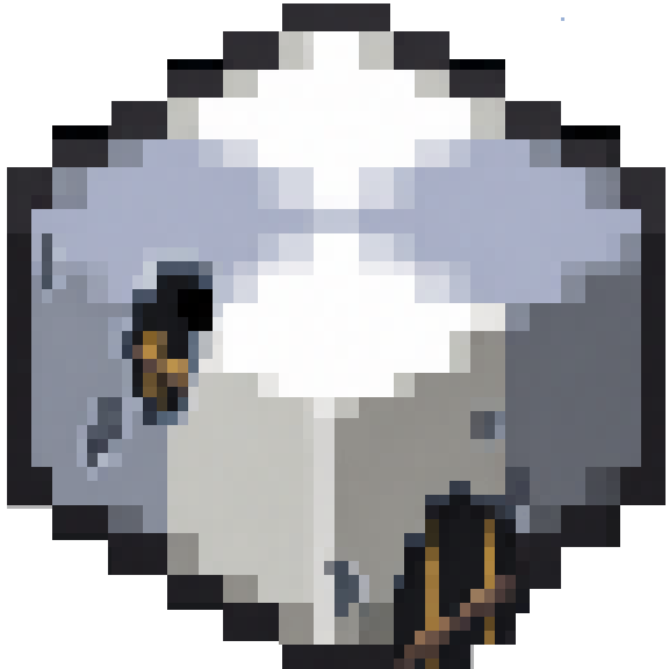
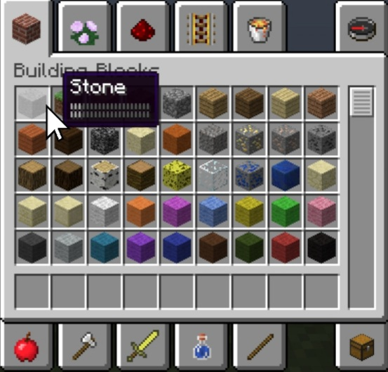
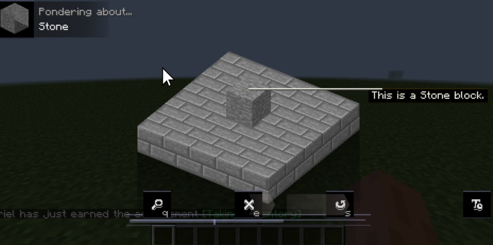
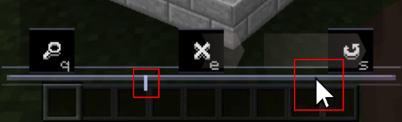
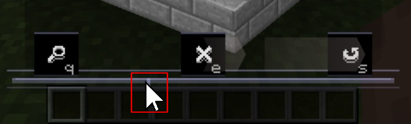
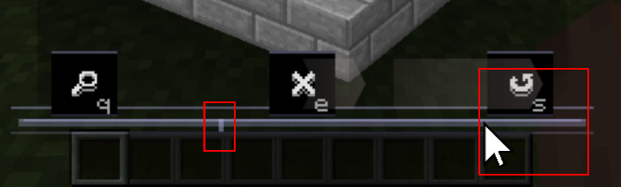

  

<h1 align="center">Ponder 1.7.10</h1>

  Interactive in-game documentation for Minecraft 1.7.10, backported from Create's Ponder.

---

## Table of contents

- [About](#about)
- [Dependencies](#dependencies)
- [Testing and showcase](#testing-and-showcase)
- [Known issues](#known-issues)
- [Credits](#credits)
- [License](#license)

---

## About

A Ponder backport for version 1.7.10. The project aims to meet the requirements of the [ReCreate](https://github.com/Gordon-Frohman/ReCreate) project (a Create backport for version 1.7.10), but it may also be usable outside of that branch.

Ponder is the visual in-game documentation system created for [Create](https://github.com/Creators-of-Create/Create). Instead of reading a wiki, players watch animated, step-by-step scenes built from small structures, with captions that explain how each block or mechanic works. This project brings that experience to the 1.7.10 ecosystem.

> [!NOTE]
> This project is under active development. Some features of the original Ponder are not available yet, and some behaviors may change between versions.

> [!IMPORTANT]
> This is an unofficial backport. It is not affiliated with, or endorsed by, the Create team or the authors of the original Ponder.

---

## Dependencies

Ponder 1.7.10 relies on Mixins and on MetaWorlds. Install both in your `mods` folder next to this mod.

| Dependency | Recommended version | Purpose | Link |
| --- | --- | --- | --- |
| UniMixins | 0.3.1 | Mixin loader for Minecraft 1.7.10 | [GitHub](https://github.com/LegacyModdingMC/UniMixins) / [Releases](https://github.com/LegacyModdingMC/UniMixins/releases) |
| MetaWorlds - Mixins | 1.6.1 | Subworlds support, used to render Ponder scenes | [CurseForge](https://www.curseforge.com/minecraft/mc-mods/metaworlds-mixins) |

> [!TIP]
> If you download the UniMixins jar, use the `-all` build. It bundles every module and is the simplest option for players.

---

## Testing and showcase

The screenshots below were taken in-game on Minecraft 1.7.10 and show the parts that are already working.

### Ponder prompt in the inventory

Hovering an item in the inventory shows a progress bar under its name. Holding the key fills the bar and opens the Ponder scene for that item.

  

### Ponder scene

After the bar fills, the scene opens with the title overlay ("Pondering about...") and a 3D view of the structure. Captions are connected to the block they describe by a guide line, and the toolbar at the bottom shows the available actions with their key hints.

  

### Status overview

| Feature | Status |
| --- | --- |
| Ponder progress bar in item tooltips | Working |
| Opening a Ponder scene from an item | Working |
| Title overlay ("Pondering about...") | Working |
| 3D scene rendering | Working |
| Captions with guide lines | Working |
| Bottom toolbar and key hints | Working |
| Timeline markers (hover and click) | Known issue, see below |

---

## Known issues

### Timeline marker cannot be clicked (hover area is misaligned)

The timeline bar at the bottom of the Ponder UI contains markers for key moments of the scene. Clicking a marker jumps to that moment, which lets you go back or forward in the scene. To click a marker, the pointer has to hover over it first.

This is not working correctly. The hover area does not line up with where the marker is actually drawn, so the pointer can sit right on top of the marker without it being detected as hovered, and the marker cannot be clicked.

The most likely cause is a mismatch between the mouse coordinates and the bounds used by the progress bar (for example, because of GUI scaling). This is still being investigated, and a fix is planned.

The red boxes in the screenshots mark the marker and the pointer position.

**Case 1: the pointer is to the right of the marker.**

  

**Case 2: the pointer is directly on the marker, but it is not detected as hovered.**

  

**Case 3: the pointer is over the right end of the bar (replay button area), far from the marker.**

  

---

## Credits

- **Gordon Frohman**, author of [ReCreate](https://github.com/Gordon-Frohman/ReCreate), the Create backport that this project was made to support. Profile: [Gordon-Frohman](https://github.com/Gordon-Frohman).
- **The Create team** and the creators of the original Ponder, for the system this project is based on. See [Ponder](https://github.com/Creators-of-Create/Ponder) and [Create](https://github.com/Creators-of-Create/Create).
- **UniMixins** by [LegacyModdingMC](https://github.com/LegacyModdingMC/UniMixins), the Mixin loader used by this project.
- **MetaWorlds - Mixins** by SergiusOnesimus ([CurseForge](https://www.curseforge.com/minecraft/mc-mods/metaworlds-mixins)), based on the original MetaWorlds mod by MMM_MasterM.

---

## License

This project is licensed under the MIT License. See the [LICENSE](LICENSE) file for details.
